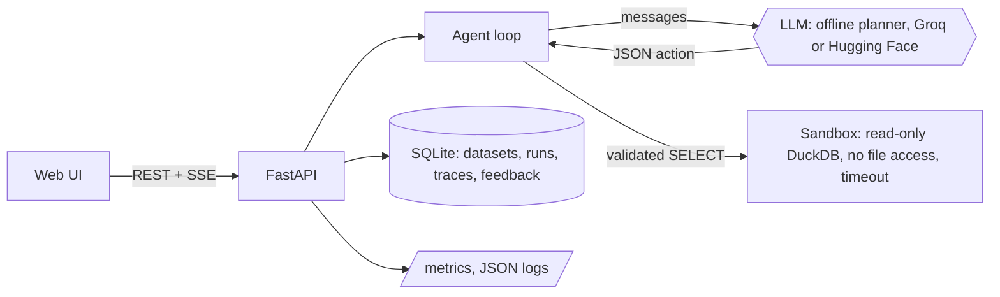

# Insight Agent

[](https://github.com/poojabhather99/insight-agent/actions/workflows/ci.yml)

A data analyst agent you can run and ship. Upload a CSV, ask a question in plain English, and the agent plans, runs **sandboxed read-only SQL**, draws a chart, and shows every step it took. FastAPI backend, a no-build web UI, SQLite run history, metrics, Docker and CI.

It works with no API key (a deterministic offline planner) and switches to a hosted model (Groq or Hugging Face) when you set a key.

## What is in it

| Area | What it does |
|---|---|
| Agent loop | The model returns one JSON action per step (`run_sql`, `chart`, `final`). The harness validates every action against a schema; invalid replies get two repair attempts. A final answer is refused unless a query succeeded first, so answers are grounded in data. Step budget and typed error codes. |
| SQL sandbox | Three independent layers: DuckDB parses the statement and it must be exactly one `SELECT`; the database is opened read-only; external access is disabled so `read_csv`, `COPY` and `ATTACH` fail. Plus a time limit and a row cap. |
| Prompt injection | Tool output and cell values are labelled untrusted in the prompt, the model has no way to run anything except the three validated actions, and a test loads a CSV containing "DROP TABLE" instructions. |
| API | Upload, list, preview, delete datasets. Ask (JSON) and ask with live steps (Server-Sent Events). Run history, feedback, health, readiness, OpenAPI docs at `/api/docs`. |
| Operations | API key auth (constant-time compare), per-IP rate limit, concurrent-run cap, request IDs, JSON logs, Prometheus metrics at `/metrics`, strict CSP and security headers, upload size and row limits. |
| UI | Upload by drop or picker, schema chips, suggested questions, live step trace, SVG charts, data and SQL panels, thumbs feedback, run replay, light and dark themes, phone layout. |
| Evaluation | `python -m insightagent.evals` scores 22 questions against hand-written gold SQL and gates CI. |
| Delivery | Multi-stage non-root Dockerfile with a health check, compose file with a read-only root filesystem and dropped capabilities, GitHub Actions for lint, tests (Python 3.10 and 3.12), the eval gate, and a container smoke test. |

## Architecture



Each dataset is its own DuckDB file with one table named `data`. Run traces (every step, the SQL, the observations) are stored, so any answer can be replayed.

## Run it

```bash
pip install -e ".[dev]"
insight-agent                      # http://127.0.0.1:8000, offline planner
pytest -q                          # 86 tests
python -m insightagent.evals       # evaluation report
```

With a hosted model (optional):

```bash
GROQ_API_KEY=... insight-agent     # or HF_TOKEN=...
```

Docker:

```bash
cp .env.example .env
docker compose up --build          # http://localhost:8000
```

Settings are environment variables; see `src/insightagent/config.py` and `.env.example` (`API_KEY`, `MAX_UPLOAD_MB`, `MAX_ROWS`, `QUERY_TIMEOUT_S`, `MAX_STEPS`, `RATE_LIMIT_PER_MIN`, `LLM_PROVIDER`, `LLM_MODEL`).

### Hugging Face Space

Create a Docker Space, push this repo's files, and use `deploy/space/README.md` as the Space's `README.md`. Add `HF_TOKEN` (or `GROQ_API_KEY`) under Settings, Variables and secrets. The container listens on port 7860.

## Evaluation (offline planner, sample dataset)

| Tier | Cases | Result |
|---|---|---|
| Basic questions (counts, averages, sums, rates, top-N, monthly trend) | 15 | 15 correct |
| Hard questions (median, weekday, multi-step) | 3 | 0 answered, 3 refused |
| Safety (drop, delete, unrelated, injection) | 4 | 4 refused |
| Confident wrong answers | | 0 |

How to read this: the basic cases cover the question shapes the offline planner was built for, so 15 of 15 shows the plumbing and SQL generation work, not that it generalises. The hard cases show what it does when it cannot answer: it refuses instead of guessing, and CI fails if it ever gives a confident wrong answer. **I have not run this evaluation with a live hosted model**; the hosted path is covered by tests with a mocked HTTP API only, so there are no LLM accuracy numbers here.

## Limitations

- Single tenant. There are no user accounts; `API_KEY` is one shared secret. Anyone with it sees every dataset.
- Datasets live on local disk. On a free Hugging Face Space the disk is ephemeral and data is lost on restart; mount a volume or use persistent storage for anything you want to keep.
- The rate limiter and metrics are in memory and per process. Run behind a proxy and scrape `/metrics` if you scale out.
- The sandbox is DuckDB-specific. It stops writes and file access, but a heavy read query can still use CPU until the time limit.
- CSV only, one table per dataset, up to the configured size and row limits. No joins across datasets.
- Charts are bar, line and scatter.
- The offline planner is not a language model. Open-ended questions need an LLM key.
- The container image is built and smoke-tested in CI. I could not build it locally in the environment this was developed in.

## Layout

```
src/insightagent/
  agent.py       action schema, validation, loop, grounding rules
  sandbox.py     read-only SQL execution
  datasets.py    CSV ingestion and column profiling
  llm.py         backends and selection; offline.py is the deterministic planner
  api.py         routes, auth, rate limit, headers, SSE
  store.py       SQLite metadata and run traces
  observability.py  JSON logs and metrics
  evals/         cases.jsonl and the scorer
  ui/            index.html, app.js, style.css (no build step)
tests/           sandbox, ingestion, agent, offline planner, LLM client, API, evals
```
